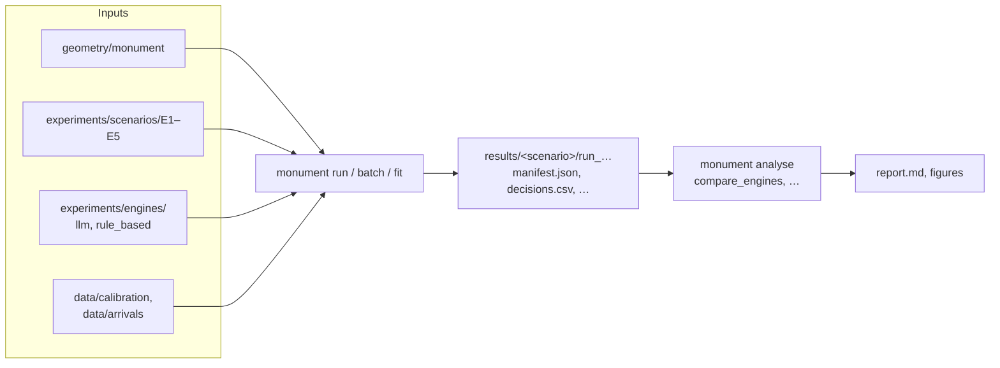

# Monument evacuation study

This study re-runs Proulx's five 1991 evacuation drills at Monument Metro
station, Newcastle, in simulation, and asks how a **language model** compares
with **rules** as the model of what each passenger decides.

## Research questions

1. **Fit.** How closely does each engine reproduce what Proulx observed: when
   the crowds started to move, and when the station was clear? Does it hold
   on drills it was not tuned on?
2. **Cost and runtime.** What does each cost per run, in time and money?
3. **Authoring effort.** How much work does each need to set up and calibrate:
   parameters, cue labels, prompts, fitting?
4. **Variability.** How much do runs vary between seeds, and how varied and
   plausible is behaviour?

The engines and the simulation are in
[evacusim](https://github.com/MJones235/llm-evacuation-sim). This repository
holds the station, the scenarios, the calibration data and the analysis.

## The flow

One run is **scenario × engine × seed**. Every run records exactly what
produced it in `manifest.json`, so any figure traces back to its inputs.

## Status (October 2026)

- **Rule-based engine:** fitted to E1, E3 and E5, with E2 and E4 held out.
  RMSE is 104 s on the fitted drills and 141 s on the held-out ones. The
  E1–E5 clearance order is right except one pair (Kendall tau +0.8). See
  [Results](results.md).
- **LLM engine:** the comparison runs are still to do.
- **Calibration:** the normal-day model still reproduces the hand-counted
  Blackett Street exit (358 simulated against 354 counted). See
  [Calibration](calibration.md).
